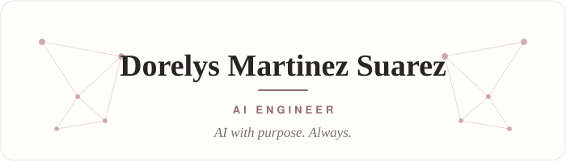
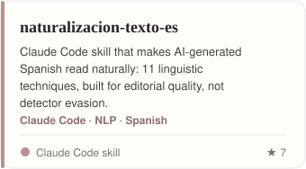
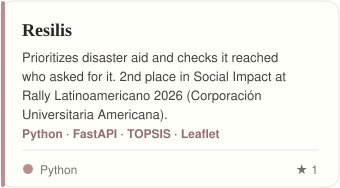
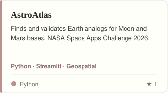
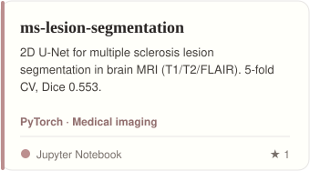
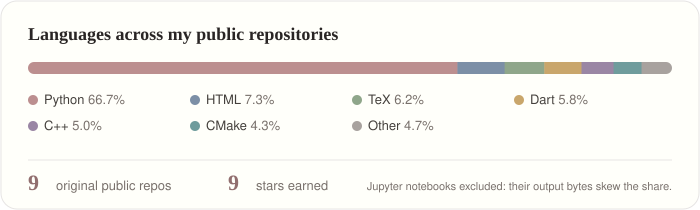

  <a href="https://dorelys.dev">
    <picture>
      <source media="(prefers-color-scheme: dark)" srcset="assets/header-dark.svg">
      
    </picture>
  </a>

  <picture>
    <source media="(prefers-color-scheme: dark)" srcset="assets/typing-dark.svg">
    
  </picture>

  <a href="https://dorelys.dev"><picture><source media="(prefers-color-scheme: dark)" srcset="assets/links/web-dark.svg"></picture></a>
  <a href="https://www.linkedin.com/in/dorelys-martinez/"><picture><source media="(prefers-color-scheme: dark)" srcset="assets/links/linkedin-dark.svg"></picture></a>
  <a href="mailto:me@dorelys.dev"><picture><source media="(prefers-color-scheme: dark)" srcset="assets/links/email-dark.svg"></picture></a>
  <a href="https://github.com/dorelysm"><picture><source media="(prefers-color-scheme: dark)" srcset="assets/links/github-dark.svg"></picture></a>

 

I'm an AI engineer with a systems engineering background and an M.Sc. in Artificial Intelligence. I build AI tools that solve real community problems, teach programming, and write down what I learn along the way at [dorelys.dev](https://dorelys.dev).

*AI with purpose. Always.*

  
<h2>🚀 Featured projects</h2>

  

    <a href="https://github.com/dorelysm/naturalizacion-texto-es"><picture><source media="(prefers-color-scheme: dark)" srcset="assets/cards/naturalizacion-texto-es-dark.svg"></picture></a>
    <a href="https://github.com/dorelysm/resilis"><picture><source media="(prefers-color-scheme: dark)" srcset="assets/cards/resilis-dark.svg"></picture></a>
    <a href="https://github.com/dorelysm/AstroAtlas-Hackaton-NASA-2026"><picture><source media="(prefers-color-scheme: dark)" srcset="assets/cards/AstroAtlas-Hackaton-NASA-2026-dark.svg"></picture></a>
    <a href="https://github.com/dorelysm/ms-lesion-segmentation"><picture><source media="(prefers-color-scheme: dark)" srcset="assets/cards/ms-lesion-segmentation-dark.svg"></picture></a>
  

  

    Live demo: <a href="https://app-production-6cc653bd.up.railway.app/?lang=en">AstroAtlas</a> · More projects on <a href="https://dorelys.dev/en/">dorelys.dev</a>
  

  
<h2>🧠 Right now</h2>

- Just completed my M.Sc. in AI, with a thesis on a study-support system that combines RAG with unsupervised student profiling.
- Founding [Praeventia Technologies](https://praeventiatech.com/), an AI and cybersecurity venture for companies.
- Teaching programming and documenting the process in my [logbook](https://dorelys.dev/es/bitacora/).
- Researching agroclimatic AI models for agriculture in Colombia.

  
<h2>🛠️ Toolbox</h2>

- **AI and ML:** Python, PyTorch, scikit-learn, RAG, LLMs, Claude, LM Studio
- **Backend and data:** FastAPI, PostgreSQL, Prisma
- **Frontend:** Next.js, React, Tailwind CSS, Astro
- **Infra:** Vercel, Cloudflare, Railway, GitHub Actions

  
<h2>🔒 Behind the scenes</h2>

Not everything lives in public repos. Some of what I'm working on, for the curious:

- An AI agent orchestration harness with security built in (PhD research candidature).
- A tracking app for chronic diseases.
- A community-listening tool.
- A semantic medical translator.

  
<h2>📊 Stats</h2>

  

    <picture>
      <source media="(prefers-color-scheme: dark)" srcset="assets/stats-dark.svg">
      
    </picture>
  

  
Generated by a GitHub Action from my public repositories. No third-party widgets.

 

  Want to build something with purpose? <a href="https://dorelys.dev"><b>dorelys.dev</b></a>

